# Diagramas de flujo

Los siguientes diagramas pueden pegarse en un editor compatible con Mermaid o utilizarse como guía para dibujarlos en Word/diagrams.net.

## Menú principal

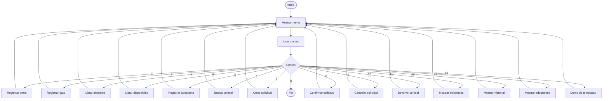

## Registrar perro/gato

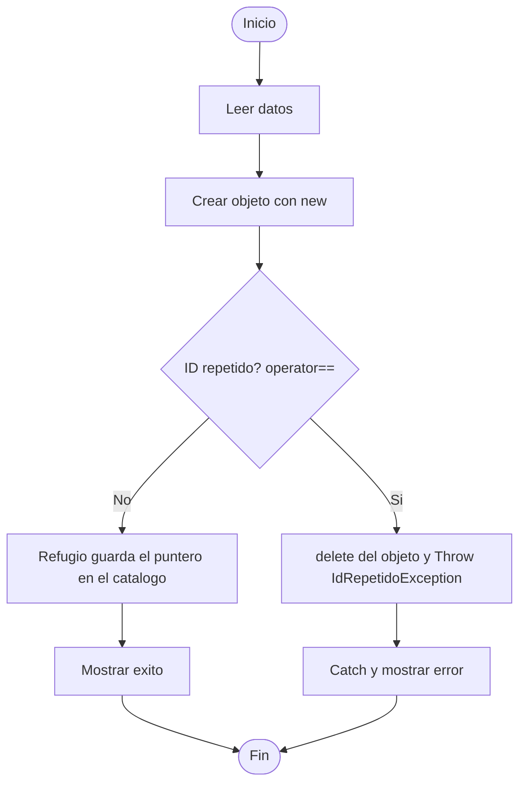

## Registrar adoptante

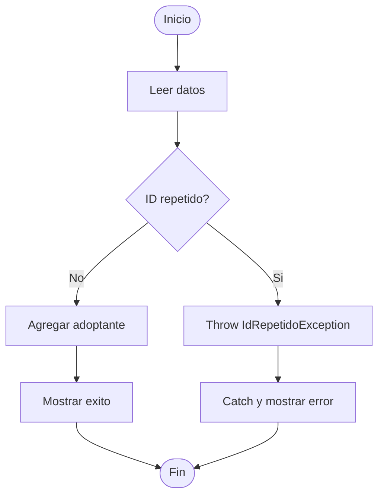

## Buscar animal

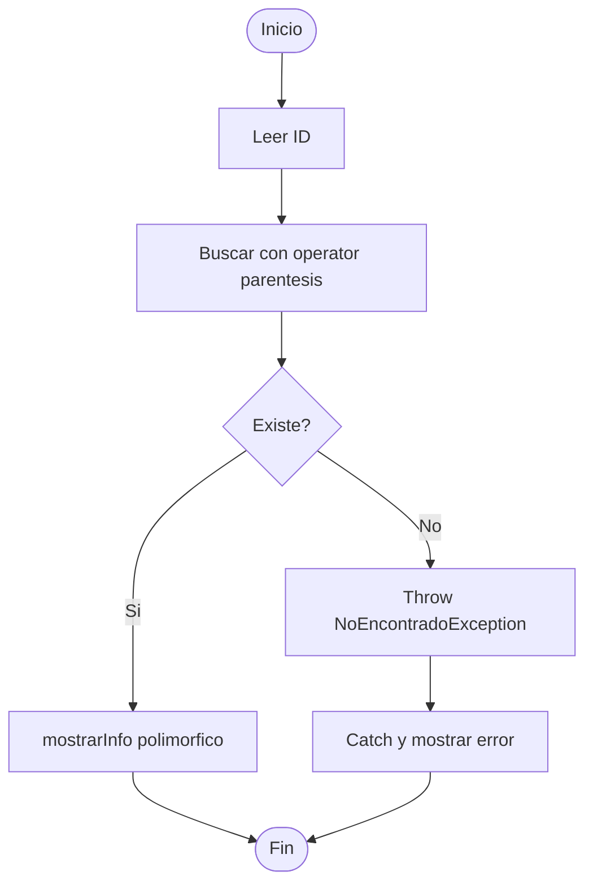

## Crear solicitud

## Confirmar solicitud

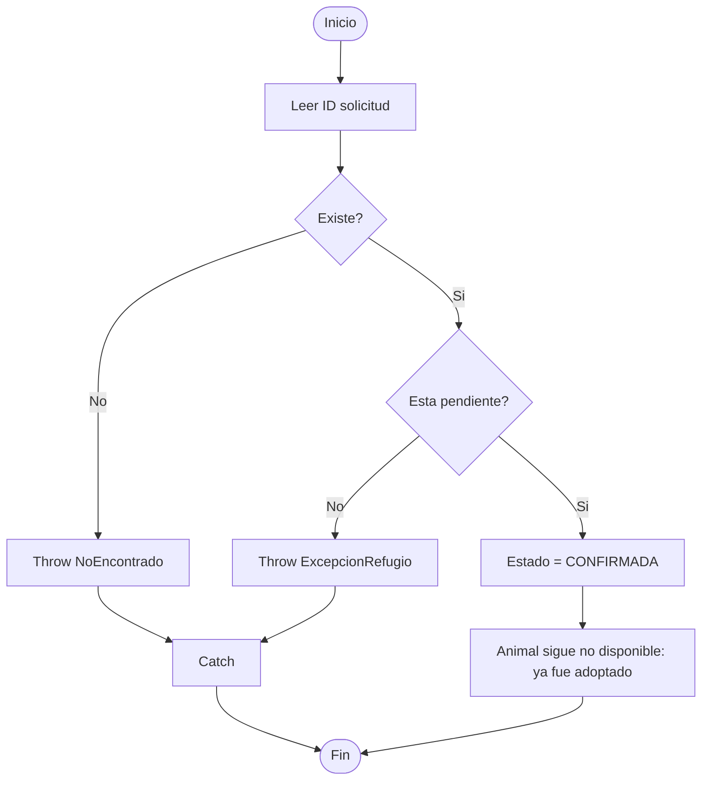

## Cancelar solicitud

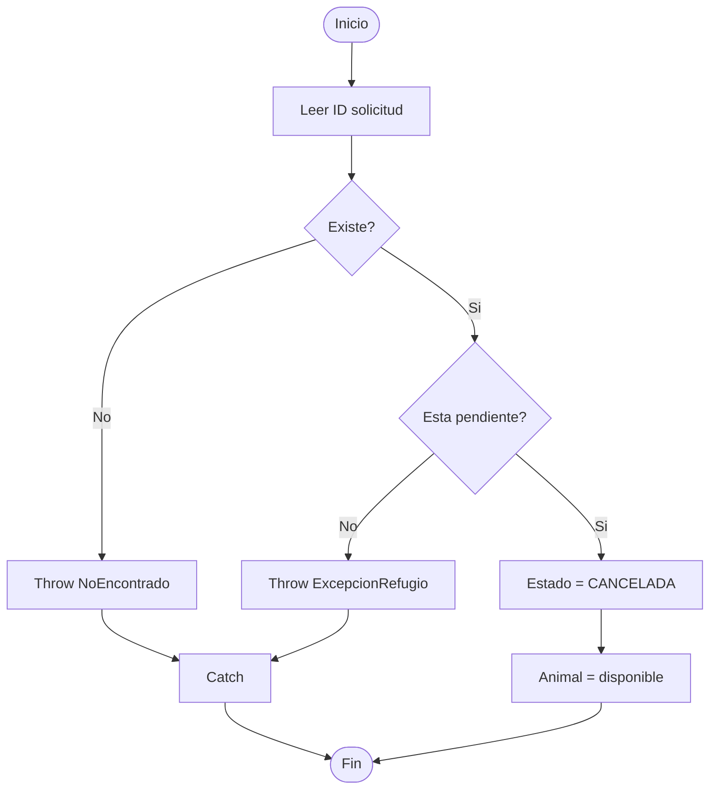

## Devolver animal

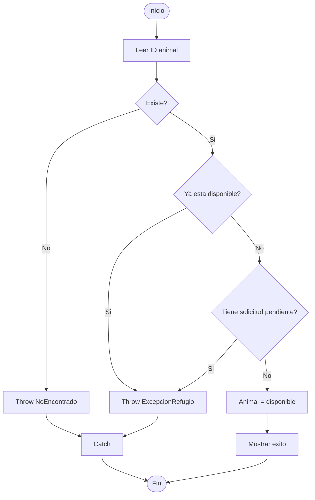

## Listar todos los animales

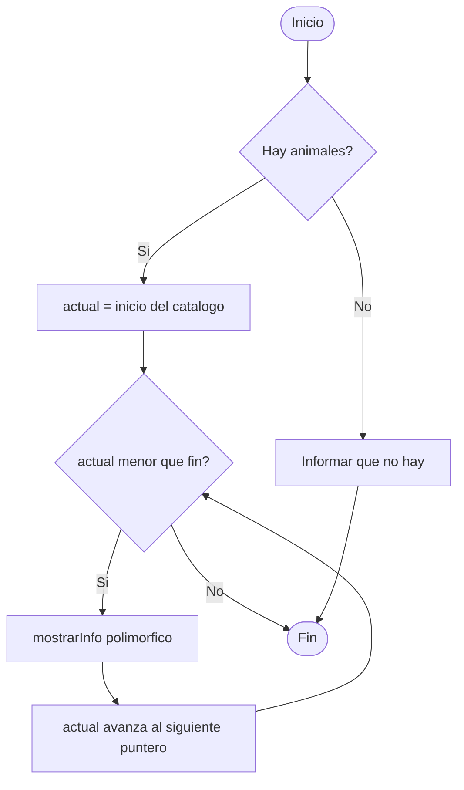

## Listar animales disponibles

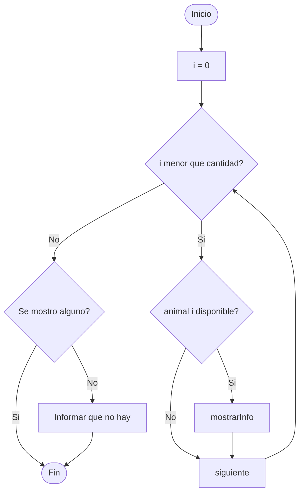

## Mostrar solicitudes

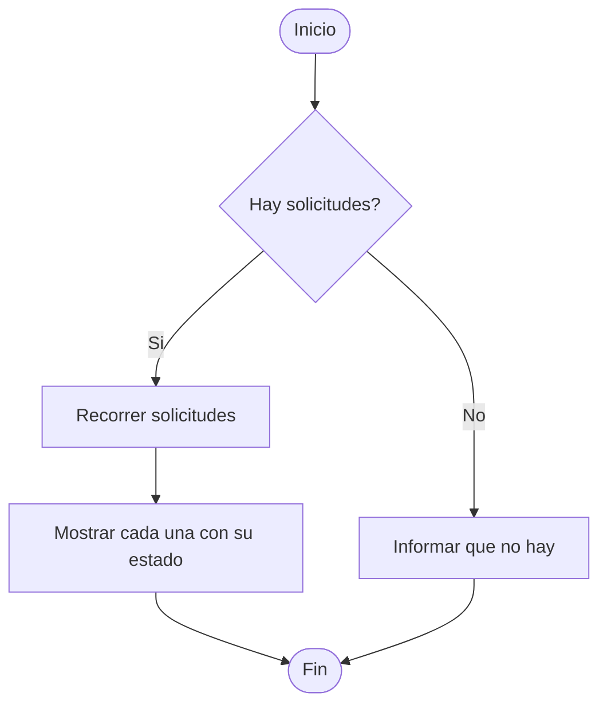

## Mostrar historial de adopciones

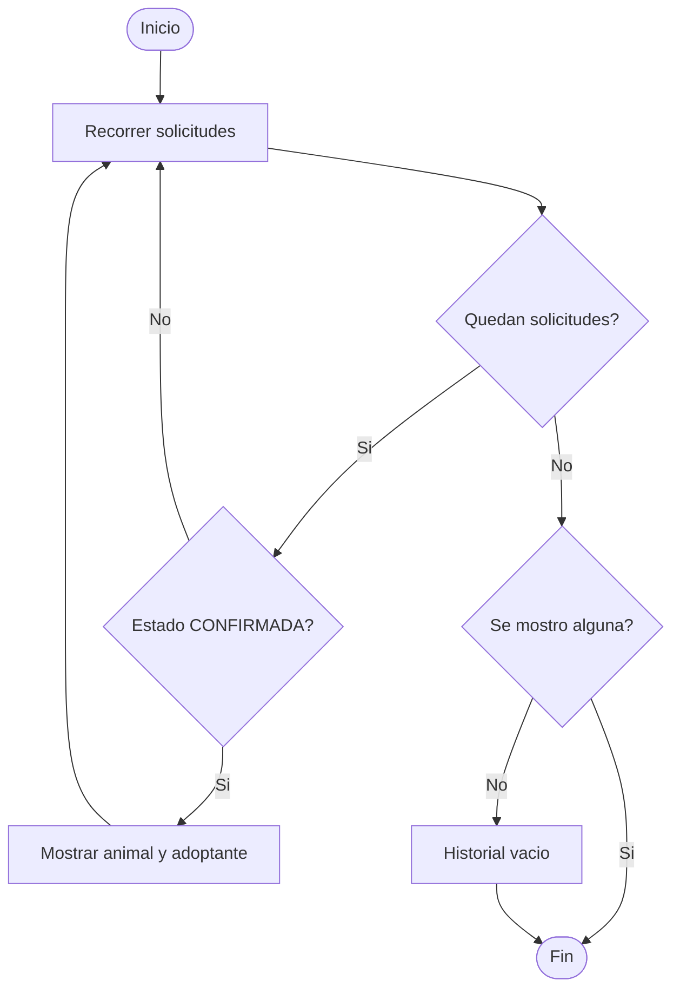

## Mostrar adoptantes

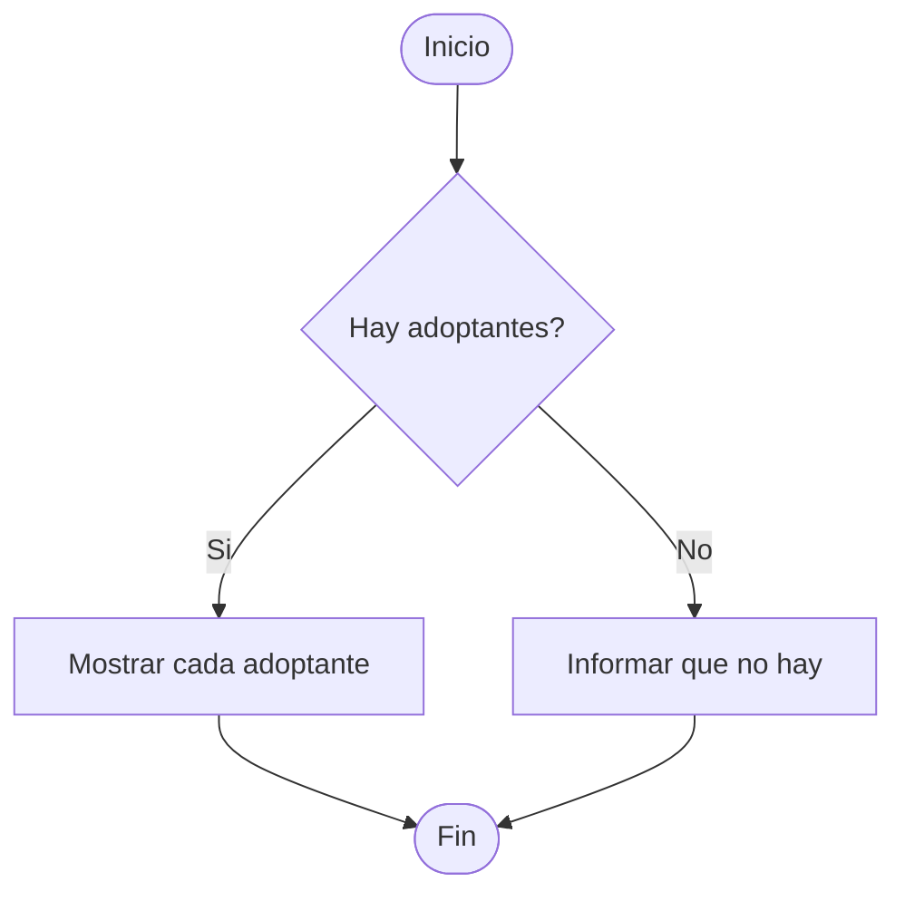

## Demo de templates

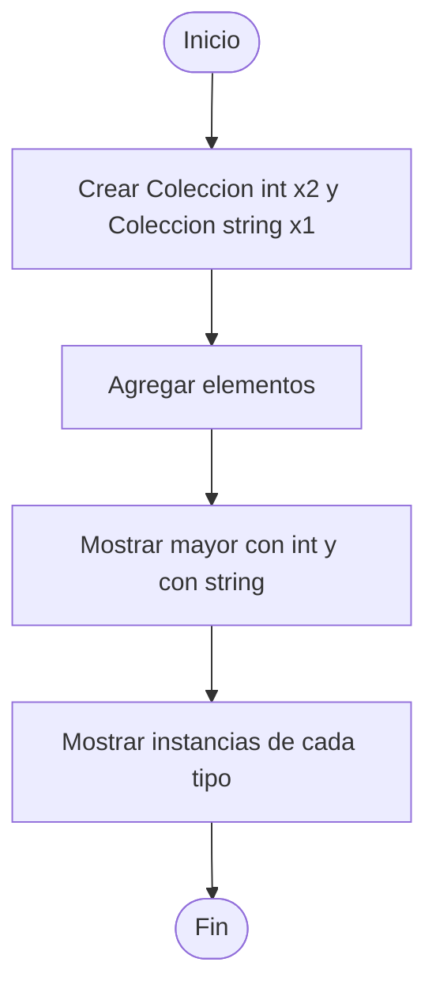

## Proceso completo de adopcion

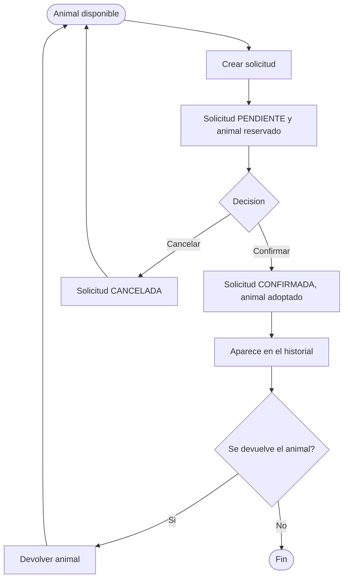
