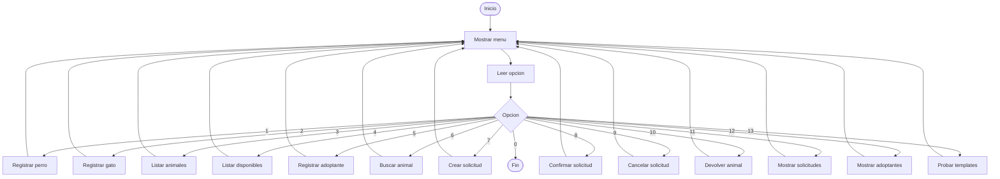
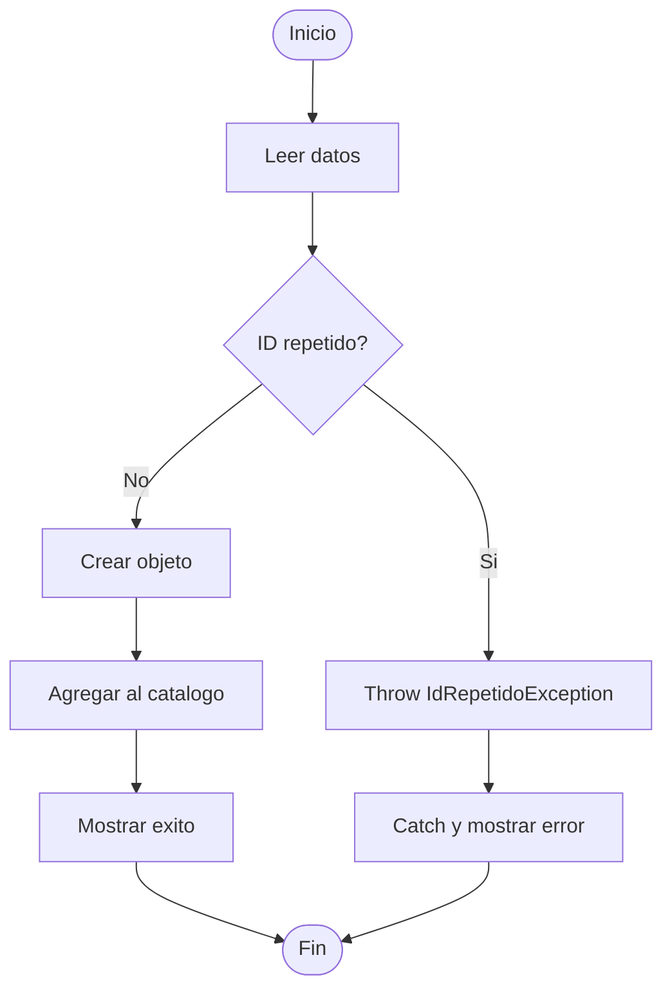
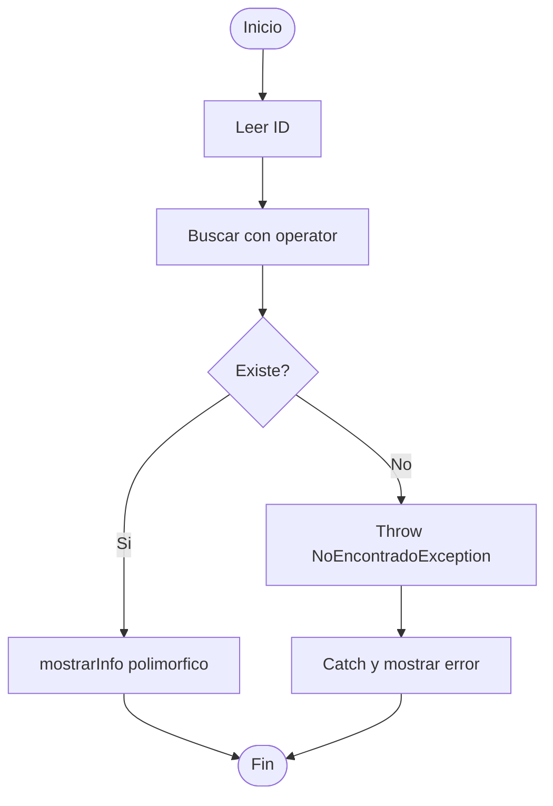
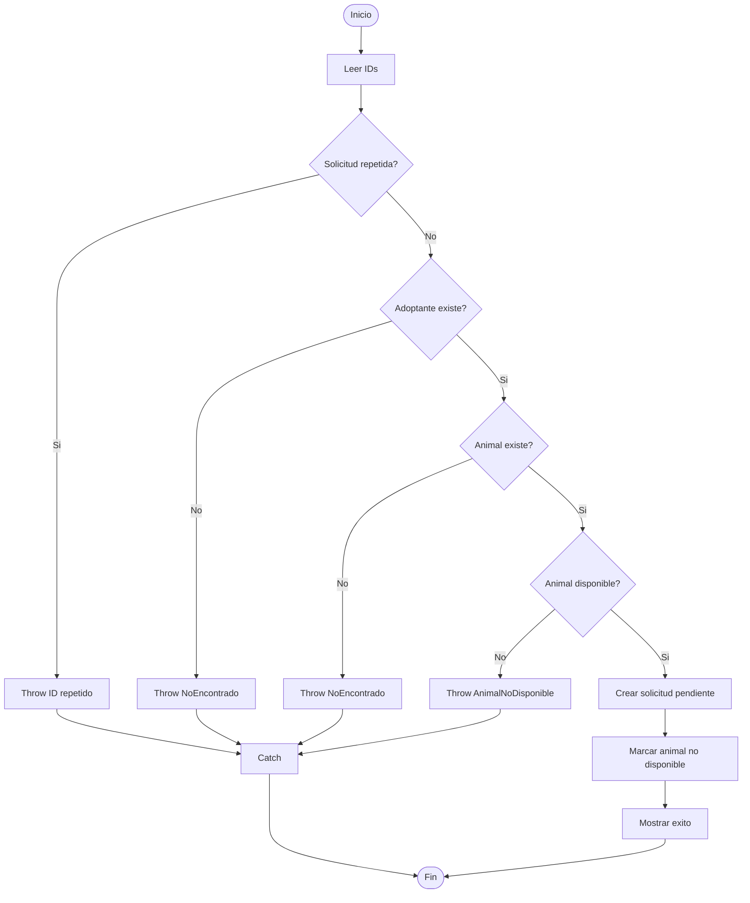
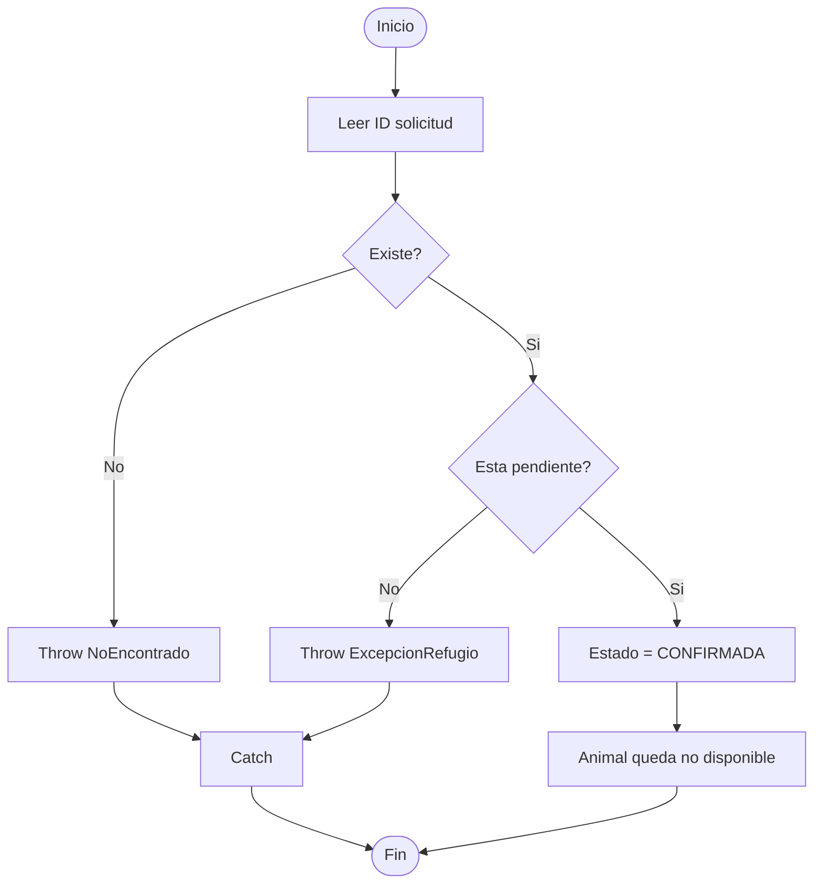
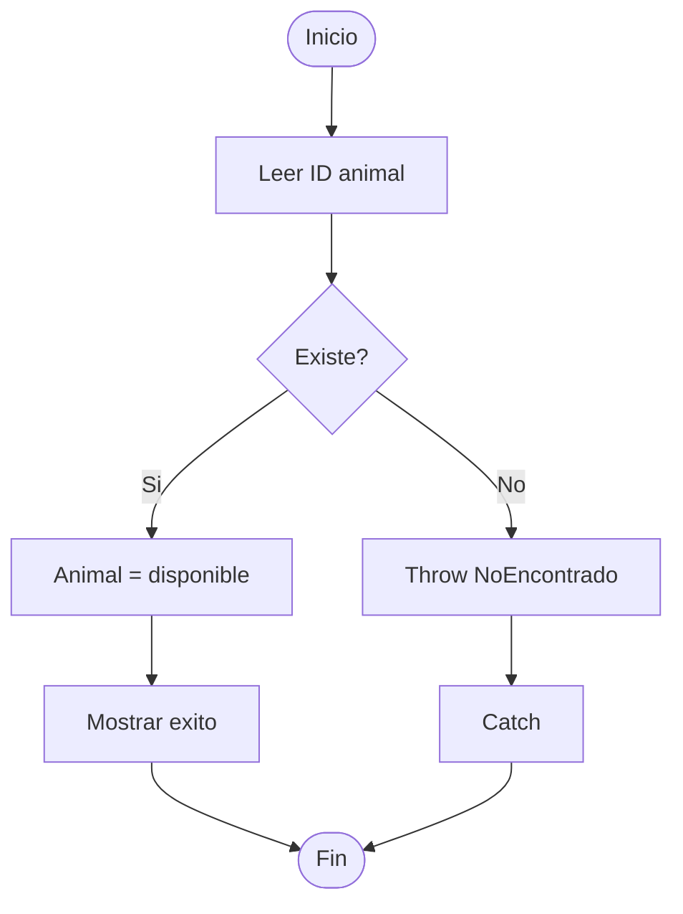
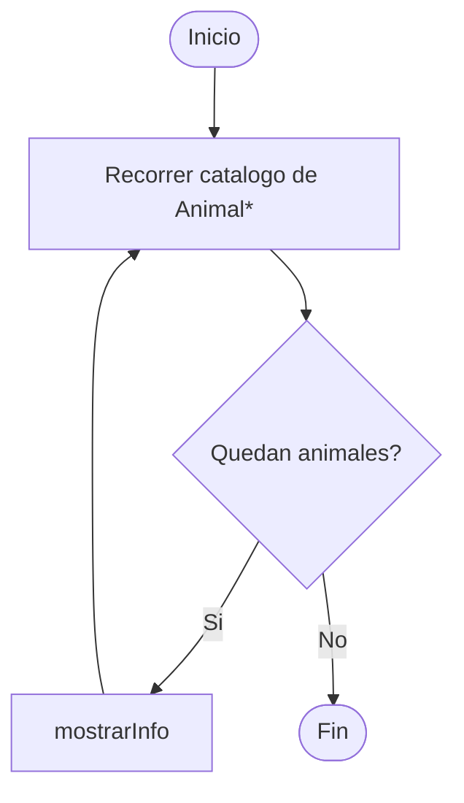

# Diagramas de flujo

Los siguientes diagramas pueden pegarse en un editor compatible con Mermaid o utilizarse como guía para dibujarlos en Word/diagrams.net.

## Menú principal

## Registrar perro/gato

## Registrar adoptante

## Buscar animal

## Crear solicitud

## Confirmar solicitud

## Cancelar solicitud

## Devolver animal

## Listados

